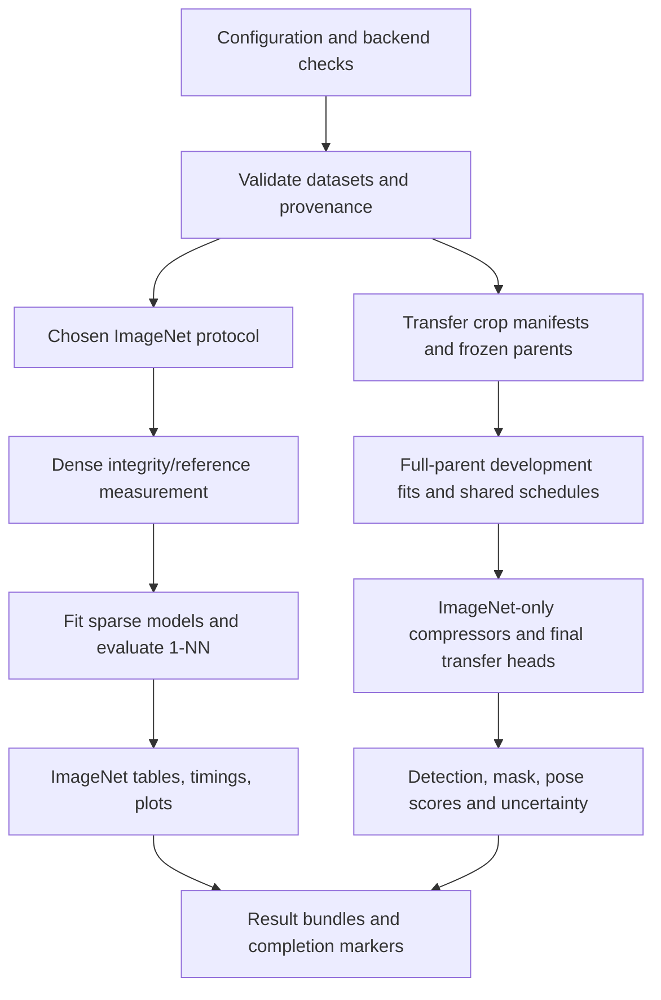

**Experiment details and benchmark reference: MMRSAE and historical MRL/CSR/MPSAE studies**

**One-command Docker Compose execution.** Copy `.env.example` to `.env`, set
`HF_TOKEN`, `WANDB_API_KEY`, and `WANDB_ENTITY`, then run `docker compose up`.
The service builds the image and runs GPU checks, data preparation, configured
MMRSAE fitting and retrieval evaluation. W&B is online by default. Data and
results persist in `./data` and `./runs/mmrsae`; `docker compose up -d` runs in
the background and `docker compose logs -f imagenet` follows progress. This
uses the current ImageNet-only defaults described below, including their
500-update cap, and reads `.env` rather than `imagenet.env`. See the
[Compose quickstart](README.md) for host prerequisites and full-data settings.

**Current workflow: MMRSAE ImageNet only.** The new method family is exposed
through [mmrsae.py](mmrsae.py) and [mmrsae_imagenet.py](mmrsae_imagenet.py).
The default Docker scope is `mmrsae`: one manually configured variant/K/seed
for ResNet-50 and ResNet-18, run sequentially. It defaults to a 500-update cap
per backbone, 128,000 fitting/gallery rows and 10,000 training-derived
development queries. Official validation is an explicit setting. It has no
automatic arm matrix, promotion gate or transfer stage.

[MMRSAE_IMAGENET.md](MMRSAE_IMAGENET.md) is the current usage and benchmark
reference; [mmrsae.env.example](mmrsae.env.example) lists the manual controls.
Data preparation resolves and records source provenance, reuses cached parent
features and supports resume. GPU FAISS and the sparse CUDA backend are
checked before data preparation; unavailable or failing GPU retrieval raises
an error. W&B logs each architecture's fitting and retrieval measurements.
The implementation was changed by source review only, with no execution,
installation, download, compilation, tests or benchmark runs for this update.

The staged repair profile and strict protocols below describe separately
available historical workflows. They are not the default MMRSAE workload.
Existing `.env` files supply defaults; explicit exported settings override them.
Use `EXPERIMENT_SCOPE=mmrsae` for the manual ImageNet path, or `repair` for the
controlled study specified in `full_theory_detail.md`.

**Short server commands.** [run_imagenet.sh](run_imagenet.sh) wraps those
ImageNet workflows. Its `init` command defaults to the theory's `repair`
profile and creates `imagenet.env` plus `imagenet.json` without overwriting
existing files:

```bash
bash run_imagenet.sh init
# Edit imagenet.env paths/GPU and imagenet.json trusted source pins first.
bash run_imagenet.sh plan
bash run_imagenet.sh run
```

For archives already on the server, set `DATA_HOST_DIR=/srv/imagenet` in the
environment file. This existing, writable directory is mounted at `/data`;
an archive at `/srv/imagenet/FF2048_RN50_Embeds/1K_train_ff2048.npz` therefore
uses `FF2048_TRAIN_EMBEDDINGS=/data/FF2048_RN50_Embeds/1K_train_ff2048.npz`.
Set `DOCKER_GPUS=device=0` to select one server GPU and leave
`REPAIR_DEVICE=cuda:0`. A blank data directory setting retains the named
volume. The initial pilot does not need the official validation archive.

`run` requests the pilot sequence described below. Follow its console output
from another terminal with `bash run_imagenet.sh logs`; results default to
`runs/mpsae_repair/`. Rerun the same command for compatible resume, keeping
code, recipe, data, output and GPU visibility unchanged. Execution stays in
the foreground; use a persistent terminal such as an existing `tmux` session
when disconnecting SSH. Later gated stages remain explicit commands.

Use `--env another.env` before the command for another configuration,
`init mmrsae` for manual fits, or `--local init` for an already prepared
Python/CUDA environment. See [the server quickstart](README.md) for the full
setup sequence. The short wrapper defaults to repair initialization; the
lower-level Docker launcher's default remains MMRSAE.

**ImageNet-only execution from configuration files.** Both new workflows can
run through `.sh` entry points. They have different experimental meanings:

| Requested work | Scope | Configuration | Command after configuring paths/provenance |
|---|---|---|---|
| One chosen new-method fit per backbone | `mmrsae` | Copy `mmrsae.env.example` to `mmrsae.env` | `ENV_FILE=mmrsae.env bash run_all_experiments_docker.sh` |
| Theory's controlled pilot: shared W, then C/S/N | `repair` | Copy `repair.env.example` to `repair.env`; point `REPAIR_CONFIG` at a copy of `experiments.json` | `ENV_FILE=repair.env bash run_all_experiments_docker.sh pilot` |
| Earlier strict CSR/MPSAE benchmark | `imagenet` | Historical `.env` protocol fields | Separate historical runner |

For a source/configuration plan, append `--plan` to the MMRSAE command or
replace `pilot` with `plan` for repair. The repair `pilot` command performs
GPU preflight, prepares training-only splits using the JSON pool sizes, runs
readiness checks, and launches at most 1,000 default fitting updates across
W/C/S/N. Each continuation starts from W. It does not launch transfer or open
official validation. Completed compatible fits and caches can be reused.

The whole controlled study remains staged: after reviewing `decisions.json`,
request `attribution`, optionally `wide`, and `timing`; set `REPAIR_CANDIDATE`
to the selected completed arm, then request `lock`, `holdout`, and `confirm`.
These use the same shell command with a different final stage. Gates still
apply. Automatically running every stage regardless of results would violate
the study's declared selection and compute protocol.

The distributed repair JSON is **not ready for real-data fitting unchanged**:
`source.revision` and `source.train_sha256` are null. Fill them from trusted
release metadata and provide the released training archive at the configured
container path. Confirmation also needs the pinned validation archive/hash.
Model, optimizer, masking, bank, OT, retrieval and gate settings live in that
JSON; the environment file selects paths, device, stage and candidate. The
runner rejects unsupported changes to fixed component contrasts. For direct
execution in an existing environment, use
`ENV_FILE=repair.local.env bash run_mpsae_repair.sh pilot` with local paths.
Both direct new-method launchers accept an explicit `ENV_FILE`.

The October 29 source review fixed stage routing, environment precedence,
config-driven splits, early GPU checks, local FF2048 provenance verification,
and late failures from unsupported singleton training batches. No launcher,
test, download, installation, compilation, training or benchmark was executed.

**Research extension:** [full_experiment_detail.md](full_experiment_detail.md)
and [full_theory_detail.md](full_theory_detail.md) now define the separate
`mpsae-repair-neighborhood-v1` profile. Its implementation and staged entry
points are described below. The original strict ImageNet and transfer protocols
remain documented afterward; their large default grid is not the research
pilot's workload.

**Repair research profile and compute gates.** Run `python make_plan.py` to
inspect the resolved arm matrix without imports of training libraries, dataset
access, or training. The research CLI is [mpsae_repair_experiment.py](mpsae_repair_experiment.py),
with the shell entry point [run_mpsae_repair.sh](run_mpsae_repair.sh). Docker
scope `repair` dispatches to this path before legacy dataset preparation or
transfer. Its default stage is `plan`; `pilot` explicitly requests the initial
sequence, and individual stages remain available.

| Stage | Work | Cumulative pilot updates |
|---|---|---:|
| Checks and splits | Mathematical checks, archive provenance, deterministic pools | 0 |
| W | Original MPSAE warm start | 250 |
| Triage C/S/N | Three continuations from W | 1,000 |
| Attribution R/M/O | Repair, masking, and old-OT controls | 1,750 |
| Optional F/A | Fixed-wide versus annealed auxiliary reconstruction | 2,250 |
| Locked development gate | 8,000 previously unopened queries | No additional training |
| Full confirmation | Fresh C/S/candidate, two seeds, ten full-data epochs | Separate 4–6-fit budget |

The pilot uses the released FF2048 training archive, K=8, h=8192, batch 1024,
and seed 1227. Its disjoint pools contain 128,000 fitting/gallery rows, 2,000
cheap development queries, 8,000 locked queries, and 1,024 training-only
landmarks. Class labels determine balanced allocation and evaluate predictions;
they do not enter reconstruction or neighborhood targets. Official ImageNet
validation is not opened for pilot selection. The 71.19% dense integrity target
below applies only to full-gallery official-validation evaluation.

Real-data checks/fits require an immutable release revision and trusted
training-archive SHA-256 in the research configuration. Confirmation additionally
requires the trusted validation-archive hash. The distributed null placeholders
support planning and cannot certify arbitrary arrays based on dimensions or
filename. Obtain those provenance values from the intended release before
spending the training budget; the implementation does not invent them.
The validation hash can be predeclared as `source.validation_sha256` before the
pilot, or supplied once through `--val-sha256` when confirmation begins. The
second route locks `validation_pin.json` without changing the already locked
pilot configuration. Docker forwards `REPAIR_VAL_SHA256` only for confirmation.

After the held-out development gate passes, the runner checks the official
archive and the full frozen parent's 71.19% integrity reference before starting
the four or six fresh fits. This ordering avoids spending that budget on an
incorrect input/evaluation pipeline. Selection is already closed; sparse
official-validation scores are computed only after their fixed-epoch fits and
do not select the method, checkpoint, or duration.

All continuations inherit the same dictionary, biases, activity counters, and
named Adam state from W. Data permutations are shared, and masking has its own
random stream. Resumable state includes the repair parameters, fixed step size,
bank refresh state, RNG state, and exact minibatch position. Checkpoints occur
every 25 updates and at endpoints; development scores do not choose an earlier
checkpoint. Original raw K/4K/2K activity bookkeeping is retained, while bank
encoding and diagnostic calls have no counter side effects.
The alpha estimate is shared and cached per common W checkpoint or fresh
confirmation seed. Fresh-initialization semantic-gradient warnings do not block
W; a relational continuation checks the restored W state's semantic signal
before its 250 updates, and unacceptable diagnostics stop that branch.

The research adapter evaluates the same reconstruction equations with indexed
sparse reductions and batches independent OT solves to reduce launch and
synchronization overhead. It first uses the declared 100-iteration solver;
if measured mass/capacity residuals exceed tolerance, it permits a logged,
bounded refinement of at most 2,000 iterations before rejecting the plan.
This policy applies to every OT-enabled research arm. C preserves the original
objective; it is not a claim of bitwise replay of the strict paper runner.
These are source-level optimizations, with no measured speedup claimed.

| Arm | Repair K/2K | Mask initial codes | Direct KL | OT cost | Auxiliary raw budget |
|---|---|---|---|---|---|
| W/C | No | No | No | Original | 4K |
| R | Yes | No | No | Original | 4K |
| M | Yes | Yes | No | Original | 4K |
| O | Yes | Yes | Yes | Original | 4K |
| S | Yes | Yes | Yes | Off | 4K |
| N | Yes | Yes | Yes | 0.5 original + 0.5 neighborhood | 4K |
| F | Yes | Yes | Yes | Same as N | max(64,8K), capped at h |
| A | Yes | Yes | Yes | Same as N | F budget linearly to 4K over 70% of updates |

S inherits an OT-trained W in the pilot; only its fresh confirmation fit is
wholly OT-free. Each row in the table is an explicit component contrast, not
an established improvement. The mixture uses one transport solve per group,
and the wide reconstruction replaces the existing 1/8 term. Served K and the
K/2K/raw-4K transport roles stay fixed in A; this differs from the older v2
schedules documented below.

The initial screen requires at least 0.3 percentage points over C on the cheap
queries, functioning sparse gradients, valid solver/output diagnostics, and
acceptable measured encoding cost. These six additional correct predictions
are a screening rule, not a claim of statistical significance. Candidate
selection and settings are locked before the other 8,000 queries are opened.
Paired, class-stratified query bootstrap intervals retain all supplied seeds
together and quantify sampling uncertainty conditional on those models.
Full confirmation must also remove the union of current minibatch row IDs
from every teacher/student landmark profile, because fitting then includes
landmark rows.

The research path reuses memory-mapped source features and clean landmark
codes, scores students against landmarks using sparse coordinates, and avoids
an n³-by-M affinity allocation. Expensive component-gradient diagnostics are
restricted to fixed training batches at selected milestones. Reports keep
encoding/repair, index construction, and search timing separate. A stored
K=8 sparse row still occupies 68 bytes in the indexed FP32 format; dense
prefixes of 16 and 17 values occupy 64 and 68 bytes respectively.

The new research outputs are excluded from strict paper aggregations. Local
MRL evaluation requires verified archive-row alignment. Reduced mask transfer
requires the exact FF2048 region parent or a separately accounted compressor
refit on the existing transfer parent; the full transfer grid is not launched
to resolve either missing prerequisite. See [VALIDATION.md](VALIDATION.md) for
the checks actually executed during implementation.

This document describes the experiment implemented in this checkout, reviewed on October 29, 2026. It covers the ImageNet protocols, GPU retrieval benchmark, downstream transfer suite, reporting, and execution settings. It complements [the method-novelty explanation](MPSAE_NOVELTY_VS_MRL_CSR.md). Executable code takes precedence where older notes or generic paper summaries differ.

**Status: this is a specification of the implemented experiment, not a completed results report.** No completed result tables, run summaries, trained checkpoints, or result ZIPs were found in the workspace during this review. Published accuracy values below are explicitly identified as references. Training, dataset downloads, GPU compilation, and benchmarks were not run to produce this document.

The experiment asks whether an adaptive representation retains useful information as its budget decreases. It examines ImageNet nearest-neighbor classification, retrieval cost, and transfer to localization, masks, and viewpoint. The primary controlled method comparison is CSR versus MPSAE on the same parent embeddings. Comparisons with MRL require attention to parent-model provenance and whether its score was measured locally.

The shared entry point is [run_all_experiments_docker.sh](run_all_experiments_docker.sh), with [run_full_pipeline.sh](run_full_pipeline.sh) as an alias. Its current default is the MMRSAE-only scope described above. Explicit `EXPERIMENT_SCOPE=all` runs the chosen historical ImageNet protocol and then the transfer suite. It first checks the GPU/backend and prepares downstream datasets and raw ImageNet training data. `imagenet` and `transfer` select one historical stage. Changing `EXPERIMENT_PROTOCOL` changes that ImageNet stage; it does not change the transfer recipe or configure the MMRSAE runner.

| Experiment | Parent/data | Compared representations | Main benchmark |
|---|---|---|---|
| `paper_ff2048` (default ImageNet protocol) | Released ResNet-50 FF2048 embeddings | Published MRL reference; local fixed-K CSR/MPSAE; secondary annealed arms | Exact normalized 1-NN top-1 and local GPU search cost |
| `paper_rn18_study` | Frozen `timm/resnet18.a1_in1k`, 512 features | Full dense reference; fixed-K CSR/MPSAE, three seeds | Exact normalized 1-NN top-1, paired differences, search cost |
| `torchvision_ablation` | torchvision ImageNet-1K V1 ResNet-18/50 | Locally fine-tuned MRL-like model; fixed and annealed sparse arms | Exploratory 1-NN and retrieval comparison |
| Frozen crop transfer | Native MRL checkpoints and separate timm parents, ResNet-18/50 | Both full parents; MRL prefixes; CSR, MPSAE, CSRv2, MPSAEv2 | VOC2007 detection; VOC2012 object masks; PASCAL3D+ viewpoint |
| Older standalone `matryoshka_*` runners | Configurable image datasets/backbones | Dense MRL versus dense MMPOT | Classification heads, optional 1-NN and linear probes; separate from current sparse experiments |

The main workflow is:



The diagram groups the logical stages. The default launcher executes the ImageNet stage before final transfer fitting; it does not run these training branches concurrently.

**Representations and training objectives are shared where the comparison permits.** MRL uses the first m coordinates of a learned dense representation. CSR/MPSAE map a parent feature x in dimension d to a dictionary of width h = 8192, retain Top-K preactivations, and apply ReLU. Their codes therefore have at most K positive coordinates. Coordinate identities remain part of the representation; a list of K values without indices is not the same code.

The sparse autoencoder uses a tied dictionary D of shape h by d:

$$
a=(x-b_{\mathrm{pre}})D^\top+b_{\mathrm{enc}},\qquad
z_K=\operatorname{ReLU}(\operatorname{TopK}(a)),\qquad
\hat{x}_K=z_KD+b_{\mathrm{pre}}.
$$

D uses Kaiming-uniform initialization; both biases start at zero. The decoder is not renormalized after optimizer steps. The shared reconstruction objective is:

$$
\mathcal R=\operatorname{MSE}(x,\hat{x}_K)
+\tfrac18\operatorname{MSE}(x,\hat{x}_{4K})
+\tfrac1{32}\mathcal L_{\mathrm{aux}}.
$$

Auxiliary reconstruction uses up to 512 inactive units and a normalized residual MSE. Activity is tested at activation greater than 1e-5; a unit is considered dead after its counter exceeds 30 Top-K activity updates. Both methods advance counters three times per minibatch, but CSR repeats the K view on its third update while MPSAE uses the 2K view. Their counter histories can consequently differ.

CSR minimizes `R + gamma * NCL`. Its visual NCL uses two deterministic copies of the K code, row normalization, and temperature 0.2. MPSAE minimizes `R + 2.0 * partial_matching_gap`. It forms K, 2K, and 4K views from the same preactivations; the 2K view has no additional reconstruction loss. Neither SAE fit uses class labels, although the parent network may have supervised pretraining.

MPSAE's transport term compares the identity matching of those three views with a competing entropy-regularized partial coupling. It uses a circular-variance cost equal to 2/9 times the sum of three pairwise cosine distances, clamped to [0,1]. Each view has uniform capacity 1/n per example and total transported mass 0.9. Unused marginal capacity contributes entropy. The solver is detached; the cost receives the approximate envelope gradient `0.9 * J - P`. The exact formulation and its interpretation appear in [the novelty document](MPSAE_NOVELTY_VS_MRL_CSR.md).

| MPSAE setting | Default |
|---|---:|
| Transport loss coefficient | 2.0 |
| Transported mass | 0.9 |
| Entropy coefficient | 0.2 |
| Maximum solver iterations | 100 |
| Constraint tolerance | 1e-4 |
| OT microbatch | 32 examples |
| Cost/plan size per full microbatch | 32 x 32 x 32 |
| Solver arithmetic | float32 |

OT is solved separately in these small groups, rather than across the entire training batch. A final group smaller than two is skipped; valid group losses are averaged equally. Training records solver diagnostics in the ImageNet runner. The transfer compressor calls the same objective but retains epoch loss/time rather than a complete transport-diagnostic history. No transport solver is used at inference. These hyperparameters are research choices, not baseline-paper settings.

**The primary ImageNet study uses released FF2048 features.** In [csr_vs_mmpot_imagenet.py](csr_vs_mmpot_imagenet.py), `paper_ff2048` requires ResNet-50 and reads the authors' two NPZ archives from `W1nd-navigator/CSR-precompute-embeds`:

```text
FF2048_RN50_Embeds/1K_train_ff2048.npz
FF2048_RN50_Embeds/1K_val_ff2048.npz
```

Each archive supplies `data` and `label`. The strict expected sizes are 1,281,167 training examples and 50,000 validation examples, with 1,000 classes and d = 2048. The parent identity is recorded as `RAIVNLab/MRL:r50_mrl0_e0_ff2048.pt`. This full-feature parent is distinct from the separately trained MRL model whose prefix accuracies supply the published comparison curve. The released arrays are consumed directly and converted to float32 for fitting; the experiment does not regenerate them from arbitrary torchvision weights.

Before sparse training, the full dense FF2048 representation undergoes the same normalized exact 1-NN evaluation. Its target is 71.19% top-1. Strict mode stops if the absolute discrepancy exceeds 0.05 percentage points. This is an input/evaluation integrity check, not an MPSAE result.

The following values are the **published Table 4 references embedded in the code**, from the [CSR paper](https://arxiv.org/html/2503.01776v1). They are not measurements produced by this checkout.

| Budget K | Published MRL top-1 (%) | Published CSR top-1 (%) |
|---:|---:|---:|
| 8 | 62.19 | 67.78 |
| 16 | 67.91 | 69.17 |
| 32 | 69.46 | 70.15 |
| 64 | 70.17 | 70.94 |
| 128 | 70.52 | 70.99 |
| 256 | 70.62 | 71.31 |
| 512 | 70.82 | 71.29 |
| 1024 | 70.89 | 71.30 |
| 2048 | 70.97 | 71.20 |

MRL's column is marked as a published reference and has no local training or retrieval timing. Local CSR is measured against the published CSR column before interpreting MPSAE's difference. The paper's stronger ResNet-50d setting is a different parent and is not substituted into this comparison.

| Sparse training control | FF2048 ResNet-50 | ResNet-18 study |
|---|---|---|
| Input dimension | 2048 | 512 |
| Dictionary width | 8192 | 8192 |
| Evaluated K | 8,16,32,64,128,256,512,1024,2048 | 8,16,64,256 |
| Independent fixed-K models | One per method and K | One per method, K, and seed |
| Training seeds | 1227 by default | 1227,1228,1229 |
| Epochs per fit | 10 | 10 |
| Batch size | 4096 | 1024 |
| Incomplete last training batch | Retained | Retained |
| Optimizer | Adam | Adam |
| Learning rate | 4e-5 | 4e-5 |
| Adam betas | 0.9,0.999 | 0.9,0.999 |
| Weight decay | 1e-4 | 1e-4 |
| Adam epsilon | 6.25e-10 | 6.25e-10 |
| CSR NCL coefficient gamma | 0.1 | 1.0 |
| Main / 4K / auxiliary reconstruction weights | 1 / 1/8 / 1/32 | 1 / 1/8 / 1/32 |
| Sparse training precision | float32; AMP and TF32 off | float32; AMP and TF32 off |
| Extra MPSAE epochs | 0 | 0 |
| Optimizer updates per 10-epoch fixed-K fit | 3,130 | 12,520 |

The update counts are derived from the official training size and the retained final batch: 313 or 1,252 batches per epoch. CSR/MPSAE pairs share initial SAE state, training inputs, optimizer settings, and shuffled-data exposure. Their training time is not assumed equal because their regularizers perform different work. No sparse learning-rate scheduler is applied in these fits.

With `paper_ff2048 --method all`, the default grid contains nine fixed-K CSR fits, nine fixed-K MPSAE fits, one annealed CSRv2 fit, and one annealed MPSAEv2 fit: **20 SAE fits**. The MRL curve and dense integrity measurement add no SAE fits. The two annealed models are evaluated at all configured budgets and are secondary extensions. The primary fixed-K curve must not be described as a single model evaluated at every K.

**The ResNet-18 protocol is a separate configuration-matched study.** `paper_rn18_study` uses frozen `timm/resnet18.a1_in1k`, the raw ImageNet training/validation images, and 512-dimensional features. It follows the CSR Appendix E.1/Table 9 setup where applicable. There is no matching published MRL curve in this protocol and no digitized Figure 4 target used as a pass/fail gate.

Training images receive random resized crop to 224 and horizontal flip. Validation uses the implemented FFCV translation: center crop at ratio 224/256, then resize to 256 square. Both use channel mean and standard deviation 0.5. Training augmentation occurs once during frozen-feature extraction; all later budgets and SAE seeds reuse that cache. The default extraction batch is 256.

An important precision distinction is visible in the code: **ImageNet's extracted feature cache is float16, and CUDA extraction uses autocast even when sparse-training AMP is disabled.** `CachedFeatures` converts these stored values to float32 for the SAE. This differs from the transfer suite's float32 extraction and caches. Thus float32 sparse training does not imply float32 parent-feature extraction throughout the repository.

The local ResNet-18 cache retains all 1,281,167 training examples. The released FFCV extractor dropped its final incomplete batch under an unpublished random order, omitting 143 unknown examples. The local preprocessing is a semantic translation, not bit-exact FFCV execution. The three local seeds vary SAE initialization and data order; they do not independently regenerate parent features. Their values are predeclared locally, not attributed to the baseline authors.

Strict `paper_rn18_study --method all` evaluates the full dense FF512 reference and trains only fixed-K CSR/MPSAE: 2 methods x 4 budgets x 3 seeds = **24 SAE fits**. V2 arms are excluded in strict mode. Results include each seed, mean, sample standard deviation, and paired-seed MPSAE-minus-CSR differences.

**The torchvision protocol and v2 schedules are explicitly separate experiments.** `torchvision_ablation` uses torchvision `IMAGENET1K_V1` weights, with d = 512 for ResNet-18 or 2048 for ResNet-50. It includes a local MRL-like backbone fit, unlike paper mode. Its settings are invocation-dependent: the Python MRL learning-rate default is 0.01, while the Docker launcher passes 0.475. The resolved run configuration, rather than the name of the method, defines this ablation.

The local MRL-like arm trains independent 1,000-class linear heads at the selected prefixes and sums their cross-entropy losses, with coefficient 1. It fine-tunes the backbone using SGD, momentum 0.9, weight decay 1e-4, and an epoch-wise cosine learning-rate schedule over ten epochs. The shared batch-size default is 4096. Training uses random resized crop/horizontal flip and the official weight normalization; cached benchmark features use evaluation transforms. It evaluates the final epoch rather than selecting a best validation checkpoint. Sparse methods use the separate frozen V1 parent with its official evaluation transform for both train and validation feature extraction.

In this ablation the fixed sparse v1 models default to a single training K of 32 and are then evaluated at multiple K values. ResNet-18 uses 8 through 512 in powers of two; ResNet-50 uses 8 through 2048. That differs from training an independent model for every K in the strict protocols.

ImageNet's annealed arms use the existing family objective while changing the training K by a rounded half-cosine schedule. Defaults start at 64, reach 2 over the first 70% of training steps, and hold at 2 afterward. CSR's K/4K codes and MPSAE's K/2K/4K views follow the current training K. This schedule is shared by CSRv2 and MPSAEv2. The local names denote these repository extensions; they do not by themselves establish a full reproduction of the authors' separately published CSRv2 method.

**The current ImageNet benchmark is exact 1-NN classification.** Every training embedding belongs to the gallery; each validation embedding is a query. The encoded rows are L2-normalized, and the label of the nearest gallery row under squared L2 distance supplies the prediction:

$$
\operatorname{top1}=100\,\frac{\text{correct query labels}}{\text{number of queries}},
\qquad
\|u-v\|_2^2=2-2u^\top v\quad\text{for unit vectors}.
$$

Here K is the representation budget, not the number of retrieved neighbors; the classifier always uses one neighbor. The current sparse runner does not perform top-5 classification, a learned ImageNet classifier-head benchmark, or linear probing. Those metrics belong to the older standalone dense runners.

Dense search uses CUDA FAISS `IndexFlatL2` with float32 vectors. Sparse search uses [sparse_gpu_retrieval.py](sparse_gpu_retrieval.py) and the local [CUDA kernel](csrc/sparse_retrieval.cu): each active query coordinate visits gallery postings containing that coordinate. Codes remain indexed sparse values; the gallery is not expanded into a dense N-by-8192 array.

All gallery postings reside on the selected GPU. Gallery chunking bounds temporary scores rather than streaming gallery data from the host. Every gallery candidate still participates, including rows with no support overlap. Zero-norm codes are rejected before normalization. Float32 atomic accumulation can alter almost-tied neighbors, so algorithmically exact search is not a claim of bitwise equivalence to dense FAISS.

| Retrieval control | Default | Meaning |
|---|---:|---|
| `FAISS_GPU` | 1 | GPU search required by the supplied experiment launchers |
| `FAISS_GPU_DEVICE` | 0 | Shared dense/sparse search GPU |
| `KNN_QUERY_BATCH` | 32 | Dense query batch |
| `SPARSE_KNN_QUERY_BATCH` | 32 | Sparse query batch; must match dense |
| `SPARSE_GALLERY_CHUNK` | 65536 | Upper bound on gallery rows in a scoring chunk |
| `SPARSE_SCORE_BUFFER_MIB` | 256 | Score-workspace budget |
| `SPARSE_GPU_MEMORY_FRACTION` | 0.8 | Device-memory ceiling used by the sparse index |
| `FAISS_TEMP_MEMORY_MIB` | 512 | FAISS temporary-memory setting |
| `RETRIEVAL_WARMUP` | 3 | Untimed searches per distinct batch shape |
| `RETRIEVAL_REPEATS` | 5 | Timed repeats of each resident query batch |

Sparse chunks are additionally capped at 4 x 1024^2 compact entries; large K can reduce the actual rows below 65,536. This bounds the estimated sorting workspace to approximately 384 MiB. Actual index bytes, chunk count, and maximum chunk rows are recorded. An index that cannot fit fails; there is no automatic CPU fallback or hidden gallery transfer during timed search.

Timing is defined by [retrieval_timing.py](retrieval_timing.py). For each resident query batch, the runner performs warmup if its shape is new, executes five timed searches, and then performs a separate untimed search for accuracy. Repetition totals are formed by summing the corresponding repeat across all batches. The primary duration is the median of those totals. This is repeated warm search per batch, not five independent complete end-to-end experiment runs.

| Included in timed search | Excluded from timed search |
|---|---|
| Score-buffer initialization/reset | Backbone extraction and SAE encoding |
| Dense/sparse distance or product work | Row normalization |
| Top-1 reduction and chunk-winner merging | Host/device input transfers |
| GPU launch gaps within the event interval | Extension compilation and index construction |
| Dispatch/completion waiting in synchronized wall timing | Label lookup and accuracy calculation |

Both CUDA-event duration and synchronized wall duration are reported. The fields named `mean_retrieval_milliseconds_per_query` and its wall counterpart divide the median repeat total by query count. They are **amortized time at the configured batch size**, not isolated single-query latency. Throughput is query count divided by that total. The final incomplete query batch is included; repeat minima/maxima and raw batch measurements remain available.

Sparse product work is also counted. For each query it is the sum of posting-list lengths for its active coordinates. `sparse_product_fraction_of_dense_dictionary` divides this work by N x h for the same dictionary space. That fraction is an operation count, not a measured speedup and not a direct comparison with an m-dimensional MRL prefix. Score initialization and reduction still cost time.

Published MRL scores have no associated local timing. In FF2048 mode the dense integrity measurement supplies one measured full-dimension reference at 2048; it does not supply measured prefix times at smaller K. Any speed comparison must use matching hardware, batch size, precision, gallery/query sets, and timing scope. In the three-seed ResNet-18 output, numeric timing summaries are arithmetic means of the per-seed summaries with sample standard deviations; raw repeats remain separate by seed.

**The transfer suite measures what frozen compact features retain for other tasks.** It is orchestrated by [transfer_experiments.py](transfer_experiments.py), with representations in [transfer_representations.py](transfer_representations.py), data construction in [transfer_data.py](transfer_data.py), and readouts/metrics in [transfer_tasks.py](transfer_tasks.py). The orchestrator protocol ID is `frozen-transfer-v1`; the task/readout protocol ID is `mrl-csr-frozen-transfer-2026-10-19-v1`.

The suite uses ResNet-18 and ResNet-50. For each architecture it has two frozen parents: a native MRL network for prefixes and a timm `resnet18.a1_in1k` or `resnet50.a1_in1k` network for all sparse methods. Both full parent vectors are evaluated as references. **MRL and sparse methods therefore have different pretrained parents in transfer.** A same-parent CSR/MPSAE comparison controls the parent; an absolute MRL/MPSAE comparison does not.

Native MRL weights come from `aniketr/mrl-resnet50` at revision `72b128ce966ea468f85905a81602e46a60106e25`. The filenames are `resnet-family/resnet18_mrl/final_weights.pt` and `mrl/Imagenet1k_R50_mrl/final_weights.pt`. The loader checks hard-coded SHA-256 hashes, reconstructs the required BlurPool architecture, removes classification weights, and strictly checks feature-network tensors. For timm, the first download resolves an immutable repository revision, then records weight and configuration hashes. All parents remain in evaluation mode with gradients disabled.

Transfer compressors are fitted **only on global ImageNet training images**. They receive no VOC/PASCAL3D+ labels or region adaptation. For each raw ImageNet index, augmentation uses CPU seed `42 + index`: random resized crop 224, scale [0.08,1], aspect ratio [3/4,4/3], bilinear antialiasing, horizontal flip probability 0.5, and standard ImageNet RGB normalization. Each timm parent produces one float32 cache, reused across tasks, methods, budgets, and seeds. This is different from the RN18 retrieval preprocessing and float16 cache.

| Transfer compressor setting | Value |
|---|---|
| Training pool | 1,281,167 ImageNet training images |
| Parent dimensions | ResNet-18: 512; ResNet-50: 2048 |
| Hidden width | 8192 |
| Initialization | Same seeded `TopKSAE` construction for each matched method/K |
| Seeds | 0,1,2 |
| Batch / epochs | 1024 / 10 |
| Optimizer | Adam, lr 4e-5, betas (0.9,0.999), epsilon 6.25e-10, weight decay 1e-4 |
| Reconstruction / auxiliary setup | Same 1,1/8,1/32 weights; auxiliary K=512; dead threshold=30 |
| CSR contrastive coefficient / temperature | 1.0 / 0.2 for both architectures |
| MPSAE transport setup | Same defaults listed above |
| Precision | Float32 extraction, cache, fitting; TF32 disabled |
| Incomplete compressor batch | Dropped: 1,281,024 examples per epoch, 143 omitted by that epoch's permutation |
| Updates per default fit | 1,251 per epoch; 12,510 over ten epochs |
| Data order | NumPy permutation from `(seed, epoch)` |
| Persistence | Model, optimizer, epoch, history, and recipe saved at each completed epoch |

The dropped batch here is an implemented transfer choice; the ImageNet retrieval SAE loaders retain their incomplete batches. Transfer uses the Table 9-style compressor settings for both architectures, so its ResNet-50 compressor is not the FF2048/Table 3 reproduction.

Fixed variants train a separate model for each K. Transfer v2 variants also train a separate model per target K, annealing from `max(64,4*K)` to K over 70% of steps. This differs from ImageNet's single 64-to-2 annealed model. By default extra MPSAEv2 epochs are zero; the transfer CLI allows a separately recorded increase. A trained compressor is reused across downstream tasks and readout families that need its K.

All final transfer settings use seeds 0,1,2. For MRL/full-parent runs these seeds affect the readout. For sparse runs they affect both compressor and readout. The following table lists compact budgets; full parent dimensions are added separately for both parent types and both readout families.

| Task / readout | MRL prefixes, ResNet-18 | MRL prefixes, ResNet-50 | K for each sparse method |
|---|---|---|---|
| Detection, primary affine | 8,16,32,64,128,256 | 8,16,32,64,128,256,512,1024 | 8,16,64,256 |
| Detection, MLP control | 16,32,64,128 | 16,32,64,128 | 16,64 |
| Mask, primary MLP and affine control | 16,32,64,128 | 16,32,64,128 | 16,64 |
| Pose, primary MLP and affine control | 16,32,64,128 | 16,32,64,128 | 16,64 |

Derived from the default complete grid, this is **570 final head fits**: 234 detection, 168 mask, and 168 pose, forming 190 three-seed result groups. There are **96 reusable compressor fits**: two architectures x four sparse methods x three seeds x four K values. Twelve full-parent development fits supply 28 evaluated checkpoints across tasks. Predetermined weak-parent diagnostics can add up to 16 development fits. These are workload counts from the loops, not counts of completed runs in this workspace.

**Transfer uses separate development and final fitting partitions.** The official source-image counts are:

| Task | Development fit / evaluation | Final fit / evaluation |
|---|---|---|
| Detection | VOC2007 train: 2,501 / val: 2,510 | trainval: 5,011 / test: 4,952 |
| Masks | Internal split of VOC2012 Segmentation train: 1,464 images | Segmentation train: 1,464 / val: 1,449 |
| Viewpoint | Internal split of VOC2012 Main train: 5,717 images | Main train: 5,717 / val: 5,823, filtered to eligible PASCAL3D+ objects |

For masks and pose, an image enters development evaluation when the integer represented by the first eight hex characters of `SHA256("mrl-csr-extensions-v1/" + image_id)` is divisible by five. Other training images enter development fitting. This is an approximately 80/20 deterministic image split, not a guaranteed exact ratio. All objects and crop variants follow their image. Actual eligible object/crop counts are recorded after filtering; the source-image counts must not be presented as pose-object counts.

Detection uses a fixed 5,000-update readout schedule. Masks and pose independently choose a common duration from 1,000, 2,500, and 5,000 updates. Selection uses seed-0 full-parent width-128 MLPs for all four parents, maximizing their mean development primary score. Ties favor fewer updates. Final heads are fitted afresh on the full official training partition. Compact-method rankings and official final evaluation labels do not select their duration. The choice is persisted in `locked_schedules.json`.

Full-parent development performance is compared with annotation-only priors for mask/pose. A parent failing to exceed the strongest relevant prior triggers separately labeled affine and width-256 MLP diagnostics. Those diagnostics do not replace the common final heads or alter the chosen primary protocol; `sensitivity.json` records the limitation.

**All region tasks use the same crop geometry.** Boxes are zero-based half-open `[x1,y1,x2,y2]`. Each box is expanded by a factor of 1.2 in width and height around its center. Left/top are floored, right/bottom ceiled. Out-of-image RGB pixels are filled with `(0.485,0.456,0.406)`. The rectangle is warped to 224 x 224 using antialiased bilinear interpolation with `align_corners=False`, then normalized by ImageNet mean `(0.485,0.456,0.406)` and standard deviation `(0.229,0.224,0.225)`.

Masks and pose encode five deterministic crops per object: the original center and shifts of plus/minus 10% of original box width horizontally or height vertically. These are separately encoded views, not shifts of a cached feature. Mask labels use nearest-exact resampling, with outside-image pixels invalid. Detection uses its proposal crop without this five-variant grid.

Readout normalization differs from retrieval normalization. A single scalar is estimated from all accepted fitting crops:

$$
s_{\mathrm{input}}=\max\left(\sqrt{\frac1N\sum_i\|u_i\|_2^2},10^{-12}\right),
\qquad u'_i=u_i/s_{\mathrm{input}}.
$$

It is shared across examples within a fit; there is no per-row L2 normalization and no use of evaluation data to estimate it. Detection excludes ignored training proposals from this normalization pool. Mask/pose include all five variants, equally by crop rather than by balanced-sampler frequency.

| Common head setting | Value |
|---|---|
| Optimizer | AdamW |
| Learning rate / betas / epsilon | 1e-3 / (0.9,0.999) / 1e-8 |
| Weight decay | 1e-4 for matrices, zero for biases |
| Learning-rate schedule | None |
| Precision | Float32; TF32 off |
| Matrix initialization | Normal(mean=0,std=0.01) |
| Bias initialization | Zero except pose's identity-oriented output bias |
| Main MLP hidden layer | Width 128, ReLU |
| Batch sampling | Presampled with replacement; plan shared across methods for a task/phase/seed |
| Checkpoints | Every 250 updates, milestone steps 1000/2500/5000, and final step |

Sparse readouts use an indexed first layer that preserves dictionary coordinates. Its parameter table still has input width 8192. Let q denote the readout width: a dense prefix has q = m, a full parent has q = d, and every sparse code has q = 8192 regardless of active K. Equal active counts do not imply equal readout parameter counts.

**The detection benchmark is R-CNN-style proposal-crop transfer on VOC2007.** Each candidate box is cropped and encoded independently. The system does not share a convolutional feature map across proposals, train an RPN, use RoI pooling, or fine-tune the frozen encoder.

Proposals come from OpenCV-contrib 4.13.x structured edges plus EdgeBoxes. The input is the original-resolution RGB image in [0,1]. The edge-model content hash and actual library version are recorded. Edge NMS uses `(r=2,s=0,m=1)`; EdgeBoxes uses:

| Parameter | Value | Parameter | Value |
|---|---:|---|---:|
| Alpha | 0.65 | Beta | 0.75 |
| Eta | 1.0 | MinScore | 0.01 |
| MaxBoxes | 512 | EdgeMinMag | 0.1 |
| EdgeMergeThr | 0.5 | ClusterMinMag | 0.5 |
| MaxAspectRatio | 3.0 | MinBoxArea | 1000 |
| Gamma | 2.0 | Kappa | 1.5 |

Boxes are stably sorted by descending objectness, with returned order breaking ties; invalid and duplicate boxes are removed. The default detector uses the first 256 proposals, or all if fewer exist. The accepted configured proposal budgets are 128,256,512. Independently of the selected budget, preparation reports proposal recall at IoU >= 0.5 and >= 0.75 for all three budgets, before appending any ground-truth boxes.

For fitting only, deduplicated non-difficult ground-truth boxes are appended. Evaluation never appends them. Proposal labels are assigned in this order:

1. Match the best non-difficult object; IoU >= 0.5 gives its foreground class.
2. Otherwise, overlap >= 0.5 with a difficult object makes the proposal ignored.
3. Otherwise, best non-difficult IoU < 0.3 gives background.
4. Remaining proposals in [0.3,0.5) are ignored.

Preparation records foreground/background/ignored counts, exact-GT positives, and objects lacking a positive proposal before GT append. Images with no proposals remain in evaluation's ground-truth denominator.

The primary affine detector has independent `q -> 21` classification and `q -> 4` class-agnostic box-regression heads. Its parameter count is `25*q + 25`. The MLP control uses separate `q -> 128 -> ReLU -> 21` and `q -> 128 -> ReLU -> 4` branches, totaling `256*q + 3481` parameters. Each training batch contains 128 sampled foreground and 384 background crops, for 512 examples and 5,000 updates.

Regression targets are center offsets and log-size ratios relative to the original proposal, not its expanded context crop. Per-coordinate means and standard deviations are estimated from fitting positives; standard deviations have a 1e-3 floor. The loss is mean 21-way cross-entropy plus the mean over positive proposals of the sum of four SmoothL1 coordinate losses, with beta = 1 and coefficient 1.

At inference, class scores are foreground softmax probabilities without objectness multiplication. Box targets are unstandardized, log-size offsets clamped to [-5,5] before exponentiation, and decoded boxes clipped to the image. Invalid refined boxes are discarded. Each class applies score threshold 0.001 and NMS at IoU 0.3; at most 100 detections remain per image across classes. Tie ordering is deterministic within the implementation.

| Detection output | Definition |
|---|---|
| `AP50` (primary) | Mean of 20 class APs, using VOC2007 11-point interpolation and strict IoU > 0.5 matching |
| `AP75` | Same 11-point rule at strict IoU > 0.75; not COCO AP |
| `AP50_no_refinement`, `AP75_no_refinement` | Original proposal boxes with the same trained classifier and evaluation processing |
| Proposal recall | Fraction of non-difficult GT objects with an original proposal at IoU >= threshold |
| `conditional_IoU_gain` | Mean refined-minus-original IoU for proposals initially at IoU >= 0.5, against their original matched GT |
| Diagnostics | Per-class AP/TP/FP/difficult counts, invalid refined boxes, eligible objects/images, proposal counts |

Difficult matches are ignored for AP and repeated detections of an already matched object are false positives. Invalid refinements contribute zero refined IoU to the conditional-gain diagnostic instead of being removed from its denominator. Detection predictions and proposal diagnostics are retained in SQLite and JSONL artifacts.

**The mask benchmark predicts a selected object's mask from its supplied box crop.** `SegmentationObject` identifies instances and `SegmentationClass` provides their categories. Object labels 0 and 255 are excluded. An eligible instance must have nonempty visible foreground with one consistent class in 1 through 20. Its tight bounding box is derived from nonvoid foreground pixels: this is an **oracle visible-extent object box**.

The target is that fixed instance alone. Other valid objects count as negative pixels. Pixels labeled void 255 in either annotation, and padding outside the image, are ignored. The learned mask head sees only the embedding; category, box coordinates, image dimensions, and spatial feature skips are not additional inputs.

The primary head is `q -> 128 -> ReLU -> 784`, reshaped into 28 x 28 logits. An affine `q -> 784` readout is the control. Parameter counts are `128*q + 101264` and `784*q + 784`. Batches contain 256 crops: choose a represented class uniformly, then an object uniformly within it, then one of its five variants uniformly. This sampling is with replacement.

During training, 28 x 28 logits are bilinearly upsampled to 224 x 224. Binary cross-entropy with logits is averaged over valid pixels separately for each crop and then averaged over crops. There is no class-weighted pixel loss or mask refinement stage.

At evaluation, logits are resized to the full original expanded crop rectangle, thresholded at zero, and then placed/clipped into the image. Pixels outside that rectangle predict background. The score is foreground IoU with the target object in original-image coordinates, using valid pixels. Nonfinite logits produce an empty mask and increment failure counts.

| Mask output | Definition |
|---|---|
| `macro_IoU` (primary, clean crops) | Compute mean object IoU per represented class, then average those class means equally |
| `instance_weighted_IoU` | Mean IoU over all evaluated instances |
| Per-class results | Mean IoU and counts for each class; unrepresented classes are unavailable |
| Translated condition | Arithmetic mean of the four separately computed shifted-crop results |
| Audit outputs | `mask_logits.npy`, per-object `predictions.jsonl`, failures, image/object/class counts |

The translated condition is not an ensemble of predictions and does not pool all shifts into one metric. This benchmark is neither official 21-class semantic-segmentation mIoU nor instance-mask AP; it evaluates conditional object-mask information in a compact feature.

Four annotation-only controls help interpret mask scores:

| Control | Construction and interpretation |
|---|---|
| Fixed central rectangle | Foreground inside normalized crop coordinates [1/12,11/12] on both axes |
| Class-agnostic mean mask | A template estimated only from fitting masks |
| True-category mean mask | A fitting template selected using the true category; explicitly privileged |
| Ground-truth 28 x 28 resolution reference | Evaluation mask reduced to 28 x 28 and decoded by the same pipeline; a resolution diagnostic, not a learned model or proven upper bound |

Templates use valid-weighted area averaging per grid cell. Probabilities are clipped to [1e-6,1-1e-6], converted to logits, and passed through the common decoder. Only the explicitly labeled resolution reference uses evaluation ground truth to construct its prediction. Cached binary target/validity maps use packed bits; their payload is 12,544 bytes per 224 x 224 crop before file overhead.

**The viewpoint benchmark estimates rotation with a supplied box and category.** It uses the Pascal portion of PASCAL3D+ associated with VOC2012 image splits. The extra ImageNet images in PASCAL3D+ are excluded. The 12 categories are aeroplane, bicycle, boat, bottle, bus, car, chair, diningtable, motorbike, sofa, train, and tvmonitor.

Eligible annotations must contain object validity fields, be non-difficult, have finite fine-grained azimuth/elevation/theta, and have positive viewpoint distance. A zero-valued angle is valid. Coarse-only or invalid annotations are excluded with recorded reasons. Training includes eligible occluded and truncated objects. Primary evaluation uses objects that are neither occluded nor truncated; secondary reports include all eligible objects and the occluded-or-truncated subset.

Angles in degrees are converted to the pinned source convention from `ViewpointsAndKeypoints`, revision `1d57050601f4a3f7842b2953be524f47d4f53b36`. This implements the passive intrinsic ZXZ convention corresponding to `angle2dcm(theta, elevation-pi/2, -azimuth, 'ZXZ')`. Canonical rotations, orthogonality, and determinant checks are part of data preparation. No category-specific symmetry equivalence is applied.

The primary head is `q -> 128 -> ReLU -> 72`, reshaped into 12 six-dimensional rotation outputs. The supplied true category selects one output. The affine control is `q -> 72`; their parameter counts are `128*q + 9416` and `72*q + 72`. Each category's output bias starts at `[1,0,0,0,1,0]`. Batch size and class/object/variant sampling match the mask task.

The six-vector becomes a rotation by normalizing its first three-vector, orthogonalizing and normalizing the second, and forming a third column by their cross product. Training minimizes mean squared matrix error, equivalent to squared Frobenius error divided by nine and averaged over examples. Degenerate vectors at tolerance 1e-6 or invalid rotations halt fitting rather than silently advancing the optimizer.

Evaluation computes the rotation error in float64:

$$
e=\frac{180}{\pi}\arccos\!\left(
\operatorname{clip}\left(\frac{\operatorname{tr}(\hat R^\top R)-1}{2},-1,1\right)
\right).
$$

Invalid predictions receive exactly 180 degrees and remain in the denominator. This failure treatment differs from excluding invalid annotations before fitting/evaluation.

| Viewpoint output | Definition |
|---|---|
| `macro_Acc30` (primary, clean primary subset) | Mean per-class fraction with error strictly below 30 degrees |
| `macro_Acc15` | Mean per-class fraction with error strictly below 15 degrees |
| `macro_MedErr` | Mean of the per-class median errors, in degrees; lower is better |
| `pooled_MedErr` | Separately labeled median across objects in the clean condition |
| Translated condition | Mean of four separately calculated shifted-crop metrics, including their class medians |
| Audit outputs | `rotations.npy`, per-object `predictions.jsonl`, GT rotations, errors, and failure flags |

Unrepresented classes are unavailable and the number of represented classes is reported. Averaging class medians differs from taking one pooled median. The nonvisual baseline predicts each category's training rotation medoid under the same geodesic distance, deduplicating crop variants and using deterministic object-ID ties. These are conditional viewpoint metrics, not detection-plus-viewpoint AVP/ARP scores.

**Statistical reporting keeps model variation and image-sampling uncertainty separate.** Transfer results report all three seeds, their arithmetic mean, and sample standard deviation. Each compact representation is compared with its own full parent at the same architecture, readout family, and seed. Sparse seeds vary both compressor and head, whereas MRL seeds vary only the head; none of these seeds retrains a parent network.

For mask and pose compact methods, the suite additionally computes paired image-cluster bootstrap intervals for compact-minus-own-parent performance. It uses 1,000 accepted replicates, bootstrap seed 2026, and 2.5th/97.5th percentiles. An image's objects and crop variants share its multiplicity. Each draw computes three paired seed differences and averages them; it does not ensemble predictions. Draws missing a required represented class are redrawn.

Automatic intervals cover clean and translated `macro_IoU` for masks, and `macro_Acc30`/`macro_MedErr` for pose's primary subset. Detection has no such bootstrap in this implementation. These intervals are conditional on the three fitted model pairs; they do not estimate backbone-pretraining uncertainty. The seed standard deviation answers a different question.

| Quantity | Stored units | Better direction |
|---|---|---|
| ImageNet `top1` | Percentage, 0 to 100 | Higher |
| ImageNet accuracy differences | Percentage points | Positive for MPSAE-minus-comparator |
| Transfer AP, IoU, Acc30, Acc15 | Proportions, 0 to 1 | Higher |
| Transfer AP/IoU/accuracy `delta_from_parent` | Difference of proportions | Positive |
| Transfer `delta_percentage_points` | Raw difference multiplied by 100 | Positive |
| Pose MedErr / angular differences, including `delta_from_parent` | Degrees | Lower / negative |
| RN18 fidelity | 100 x sparse accuracy / full dense accuracy | Higher; it is a ratio, not an accuracy difference |

Transfer plots place representation bytes per region on a base-2 logarithmic x-axis. They show mean scores and sample-standard-deviation error bars, with separate full-parent reference lines. Detection plots AP50/AP75; mask plots clean/translated macro IoU; pose plots clean/translated macro Acc30 and macro median error. Figures are saved as PNG and PDF.

**Storage and parameter costs are reported alongside accuracy.** Equal K is not equal storage between a dense prefix and an indexed sparse code.

| Representation or structure | Payload/accounting |
|---|---|
| Dense transfer prefix | 4*m bytes per region; prefixes share a stored full-parent feature cache |
| Sparse transfer cache | FP32 values `[N,K]`, uint32 indices `[N,K]`, uint32 nonzero counts `[N]`: 8*K+4 bytes per row before headers/metadata |
| Hypothetical unpadded sparse payload | 8*mean_nnz+4 bytes per region, reported separately from the padded files |
| Actual sparse transfer storage | Serialized directory bytes divided by rows, including padding and metadata |
| Dense retrieval gallery | 4*N*K vector bytes; labels and FAISS scratch tracked separately |
| Sparse retrieval posting index | 8*actual_nnz + 8*chunk_count*(h+1) + 8*h bytes |
| Retrieval labels | Another 8*N bytes |
| Sparse score workspace | 4*query_batch*largest_chunk_rows bytes |

Retrieval's compact coordinates/gallery row IDs are int32 with float32 values; posting offsets and aggregate feature counts use int64. Transfer cache coordinates/counts use uint32. These formats serve different interfaces and should not be described as one universal sparse-file layout.

The tied SAE has `d*8192 + 8192 + d` trainable parameters: 4,203,008 for ResNet-18 and 16,787,456 for ResNet-50. These model parameters are separate from per-example representation storage. Sparse readout tables and optimizer state also remain large because their width is 8192, even at small active K.

Transfer reports encoder extraction, compressor fitting, code generation, head fitting, and evaluation times separately. Shared extraction/compression time includes cache I/O and must not be added repeatedly for every readout that reuses a cache. Evaluation includes head prediction, postprocessing, and artifact work. PyTorch peak allocated GPU memory and process peak CPU RSS, where available, are component diagnostics. Neither these timings nor the search-only ImageNet timings establish complete image-to-output deployment latency or total deployment memory.

**Results are written at both per-fit and aggregate levels.** With the default Docker configuration, the host suite root is `runs/three_method_ablation/`, with ImageNet outputs under `resnet50/` and transfer outputs under `frozen_transfer/`. The RN18 template instead chooses `runs/rn18_appendix_e1_study/`. The shell ImageNet launcher appends the backbone directory; direct Python uses exactly the requested `--output-dir`.

| ImageNet artifact | Contents |
|---|---|
| `<backbone>/summary.json` | Resolved configuration, protocol, provenance, integrity result, histories, metrics, timing records, runtime |
| `<backbone>/<method>/results.json` | Method benchmark results |
| `<backbone>/<method>/k_K/history.json` | FF2048 independent fixed-K training history |
| `<backbone>/<method>/seed_S/k_K/history.json` | ResNet-18 seed/K history |
| `paper_ff2048_reproduction.csv/.md` | Published MRL/CSR, local CSR, CSR reproduction gap, MPSAE, MPSAE-minus-local-CSR and minus-published-MRL |
| `paper_rn18_study.csv/.md` | Dense reference, CSR/MPSAE seed summaries, paired differences, fidelity |
| `retrieval_timing.csv/.md` | Locally measured timings, nonzeros, device/backend, batch, preparation/setup fields |
| Corresponding PNG/PDF files | Primary accuracy curves and retrieval-time figures |
| `ablation_<backbone>_training_loss_history.csv` | Recorded objective components over epochs |
| `ablation_<backbone>_loss_component_impact.csv/.json` | Weighted contributions and observed decreases; not causal ablation effects |

The timing and full JSON records also contain nearest-neighbor squared distance, gallery/query counts, actual average nonzeros, index/chunk/workspace statistics, raw repeated measurements, and software/device information. Some training plots use one representative K/seed; they do not show every fit simultaneously. Secondary `comparison.csv` and `comparison_table.md/.tex` are generated when the required methods exist and are not substitutes for the protocol-specific primary tables.

| Suite aggregation | Main files |
|---|---|
| FF2048 | `ff2048_reproduction_summary.json`, `ff2048_reproduction_per_budget.csv`, `ff2048_reproduction_results.md`, `imagenet_ff2048_comparison_results.zip` |
| ResNet-18 | `rn18_study_summary.json`, `rn18_study_per_budget.csv`, `rn18_study_results.md`, `imagenet_rn18_csr_mpsae_study_results.zip` |
| Torchvision ablation | `architecture_ablation_summary.json`, `architecture_ablation_per_budget.csv`, `architecture_ablation_effect_summary.csv`, `architecture_ablation_results.md/.tex`, `imagenet_architecture_ablation_results.zip` |

Aggregation checks protocol consistency and required methods/budgets. Paper aggregates reject non-strict results. ImageNet bundles contain selected reports, figures, logs, and provenance with an artifact hash manifest. Keep the full output directory: do not assume every individual per-K history is included in the ZIP. In legacy architecture-effect summaries, variability across budgets/backbones is descriptive and is not independent-seed uncertainty.

Transfer fits use paths of this form:

```text
frozen_transfer/<task>/<development|final>/<architecture>/<method>/
  budget_K/<affine|mlp>/seed_S/
```

| Transfer artifact | Contents |
|---|---|
| `configuration.json`, `runtime.json`, `datasets.json` | Resolved run, source fingerprint, software/device, dataset and checkpoint provenance |
| `readout_interface_check.json` | Indexed-readout interface check performed by the runner |
| Per-task `data_fit.json`, `data_evaluation.json` | Image/object/crop counts, exclusions, annotation hashes, proposal recall |
| Per-task `controls/controls.json` | Annotation-only control results |
| `locked_schedules.json`, `sensitivity.json` | Development selection and full-parent prior diagnostics |
| Per-fit `config.json`, `fit.json`, `result.json` | Readout setup, fitted normalization/target statistics, metrics and costs |
| Per-fit `training.jsonl`, `last.pt`, `checkpoint_*.pt` | Training log and resumable optimizer/model/RNG state |
| `compressors/<arch>/<method>/seed_S/k_K.pt` | Resumable compressor and optimizer state |
| Prediction artifacts | Detection SQLite/diagnostic JSONL, mask logits, rotation arrays, object prediction JSONL |
| `summary.json`, `summary.csv` | Per-seed rows, grouped mean/sample SD, own-parent differences and uncertainty |
| `uncertainty/`, `plots/`, `plots.json` | Bootstrap reports and PNG/PDF plots |
| `events.jsonl`, `status.json`, `logs/pipeline.log` | Progress and status |
| `failure.txt` / per-fit `failure.json` | Recorded failure context |
| `transfer_results.zip` | JSON reports, summary CSV, exclusion reports and plots |
| `RUN_COMPLETE.json` | Written after the requested grid and summary finish |

Transfer feature caches, checkpoints, sampling plans, and individual prediction arrays/databases stay on persistent storage outside the portable ZIP. For `EXPERIMENT_SCOPE=all`, the suite-level completion marker covers both stages; the earlier ImageNet marker is preserved as `IMAGENET_RUN_COMPLETE.json`.

**Execution depends on configuration files and persistent resources.** The host Docker launcher loads `.env` by default, or the file selected by `ENV_FILE`. Explicit exported variables override file defaults; the resolved experiment settings are forwarded to Docker. The standalone transfer shell launcher consumes environment variables but does not itself source `.env`.

For the default complete suite, prepare `.env` from [.env.example](.env.example), configure the required Hugging Face access, and launch:

```bash
# Create .env from .env.example if you do not already have one.
# In .env: EXPERIMENT_SCOPE=all, EXPERIMENT_PROTOCOL=paper_ff2048
bash run_all_experiments_docker.sh
```

For ImageNet only, set `EXPERIMENT_SCOPE=imagenet` in `.env`. For the RN18 protocol, use the settings in [rn18_study.env.example](rn18_study.env.example) and explicitly set scope if only ImageNet is desired: that template omits `EXPERIMENT_SCOPE`, so the default remains `all`. For a transfer restart set `EXPERIMENT_SCOPE=transfer` and preserve the original output/cache locations.

In a prepared local environment, direct entry points are:

```bash
python csr_vs_mmpot_imagenet.py \
  --protocol paper_ff2048 --backbone resnet50 --method all \
  --data-root /path/to/CSR-precompute-embeds \
  --output-dir runs/ff2048/resnet50

python csr_vs_mmpot_imagenet.py \
  --protocol paper_rn18_study --backbone resnet18 --method all \
  --data-backend imagefolder --data-root /path/to/imagenet \
  --output-dir runs/rn18/resnet18

bash run_transfer_experiments.sh --plan
bash run_transfer_experiments.sh --prepare-only
bash run_transfer_experiments.sh
```

These are Bash/Linux-style examples. The plan command prints configuration without downloads or training but still requires the Python environment/imports. Preparation validates/downloads datasets and creates shared manifests; with sparse methods selected it also prepares raw ImageNet training data. FF2048 embeddings alone are insufficient for the transfer compressor stage.

| Runtime/configuration control | Default or behavior |
|---|---|
| Docker base | `nvidia/cuda:13.0.2-devel-ubuntu24.04` |
| PyTorch / torchvision | Repository pins 2.13.0 / 0.28.0 |
| timm / datasets | Repository pins 1.0.20 / 5.0.1 |
| Other required components | NumPy, SciPy for MATLAB annotations, OpenCV-contrib 4.13.x, safetensors, Matplotlib, Ninja, CUDA FAISS |
| GPU build prerequisites | Compatible CUDA toolkit with nvcc, C++ compiler, Ninja; NVIDIA Docker GPU access for the container route |
| FAISS packaging | Linux x86-64 CUDA wheel; Docker ARM64 builds FAISS 1.14.3 for sm_121 |
| Docker shared memory | 16g |
| Persistent container locations | `/data` for data/cache/weights/extensions; `/output` for results |
| ImageNet loader workers / prefetch | 8 / 2 |
| Transfer workers / parent feature batch / sparse encode batch | 4 / 64 / 1024 |
| Transfer download / image verification | Enabled by default |
| Dataset access | Hugging Face credentials with required access for gated sources |
| Optional W&B | ImageNet runner supports online/offline/disabled; disabled by default without a key |

These versions describe the repository's dependency specification and Docker recipe, not a newly verified working installation. The complete dependency constraints are in [requirements.txt](requirements.txt) and [Dockerfile.all-experiments](Dockerfile.all-experiments).

Strict paper mode validates controlled settings, data sizes, budgets, and precision. Deliberate deviations require `--no-paper-strict` and a separately labeled ablation; such output is not accepted as a strict paper aggregate. Transfer enforces official dataset counts, seeds 0/1/2, and both architectures when mask/pose schedule selection requires all four parents. Optional PCA, regional compressor adaptation, CSR-on-MRL parents, label-efficiency studies, keypoints, textures, descriptors, and joint detection/viewpoint are outside the primary implemented matrix.

Transfer caching and checkpoint reuse are keyed by configuration, source hashes, parent identities, data/annotation fingerprints, and fit recipes. Incompatible existing state raises an error instead of being silently reused. Feature/code extraction resumes from durable cursors; compressors resume at completed epochs; heads resume from saved updates. OS locks prevent concurrent writers. Nonfinite training values and degenerate pose fits are recorded as failures. The historical strict ImageNet SAE runner saves histories and metrics without model/optimizer checkpoints, so restarting that stage restarts its fits. The repair and MMRSAE runners described above save resumable model, optimizer and RNG state.

**The older dense runners remain available for a different experiment.** [matryoshka_mmpot_experiment.py](matryoshka_mmpot_experiment.py) uses a pairwise OT proxy, while [matryoshka_real_mmpot_experiment.py](matryoshka_real_mmpot_experiment.py) supports the explicit three-marginal dense-prefix objective. Neither is invoked by the default current suite or defines sparse MPSAE.

Their defaults include ResNet-50, random initialization unless `--pretrained`, seed 42, five epochs, batch 256, SGD learning rate 0.1, momentum 0.9, weight decay 1e-4, cosine scheduling, and AMP enabled. They use mean prefix cross-entropy by default, with configurable reductions/heads. Their OT defaults are weight 0.5, mass 0.8, entropy 0.1, 50 iterations, and tolerance 1e-4. These settings must not be copied into the current sparse protocol by name alone.

| Legacy benchmark | Behavior |
|---|---|
| `head` (default) | Trained prefix classifiers: cross-entropy, top-1, top-5; mean-prefix and full-prefix summaries |
| `knn` (optional) | Exact dense L2 1-NN; normalization off unless explicitly requested; default gallery/query chunks 16384/256 |
| `linear` (optional) | Fresh prefix probes on a frozen encoder, default five-epoch SGD lr 0.1, momentum 0.9, weight decay 0, cosine schedule; top-1/top-5 |

Those runners save `last.pt` and `best.pt` and support resume. Default benchmark checkpoint selection uses the best mean-prefix validation top-1; it differs from evaluating a final fixed-epoch SAE. [summarize_results.py](summarize_results.py) reads their `mrl/mmpot -> head/knn/linear -> per_dim` schema. Current sparse and transfer results should be read through their own tables and aggregators.

When writing conclusions, distinguish the comparisons actually made. FF2048 measures a local CSR reproduction gap and MPSAE's difference from that local CSR; its MRL curve is a published reference. RN18 adds three-seed paired evidence on a different parent. Transfer measures compression relative to each method's own parent on three related PASCAL task settings. Search timing, component timings, loss-contribution plots, and representation-byte counts each answer different questions. A claim that the transport term causes an improvement still requires matched loss ablations; neither a configured benchmark nor a loss plot supplies that result.


