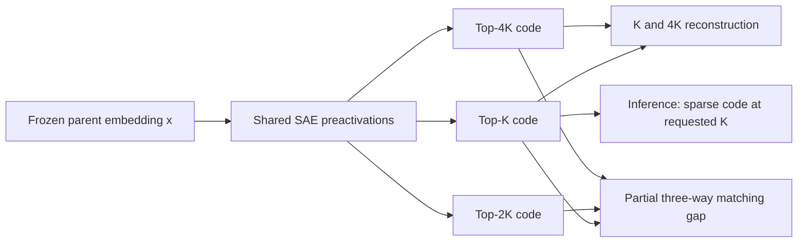

**MMRSAE and its MPSAE baseline: comparison with MRL and CSR**

**Current family name: MMRSAE.** The repair/neighborhood method and its
variants are now exposed as the `MMRSAE` class in [mmrsae.py](mmrsae.py).
`mmrsae` combines masked sparse repair, direct neighborhood KL and mixed OT;
`mmrsae-rel` omits OT; `mmrsae-wide` and `mmrsae-annealed` change the auxiliary
raw reconstruction budget while keeping served K fixed. These names identify
configurable presets, not demonstrated performance differences.

The public [ImageNet runner](mmrsae_imagenet.py) supports manual experiments
on ResNet-50 and ResNet-18 with W&B and mandatory CUDA retrieval. The default
is one selected configuration per architecture, with training-derived
development evaluation. See [MMRSAE_IMAGENET.md](MMRSAE_IMAGENET.md).
The earlier MPSAE baseline and staged research-arm identifiers below keep
their original names to preserve the meaning of existing results and code.

**New research extension.** The implementation now also contains the separate
repair/neighborhood profile specified in [full_theory_detail.md](full_theory_detail.md)
and [full_experiment_detail.md](full_experiment_detail.md). The original MPSAE
comparison below remains the baseline explanation. The extension adds a
learned residual correction to the small codes and teacher-defined neighborhood
information; it does not redefine the strict CSR or original MPSAE protocols.

For a raw code z, one repair step uses
`r = x - b_pre - zD`, followed by
`TopK_positive(z + alpha*r*D.T + ReLU(rU)*V)`.
U/V have rank 32, U starts random, and V starts at zero. A fixed step size is
estimated from the initial dictionary and checked on training diagnostics.
During training, a row is forced clean with probability 0.2; otherwise each
positive starting coefficient is erased independently with probability 0.25,
without rescaling. Inference uses the clean start and stores the final projected
code, still with at most K positive coordinates.

Teacher and student profiles describe similarities to the same ordered bank
of 1,024 training examples. A teacher-to-student KL supplies a simpler direct
distillation control. The proposed neighborhood cost is
`1 - sum_r (pK_i[r] * p2K_j[r] * teacher_l[r])**(1/3)`.
The mixed arm combines this with the original angular cost at weights 0.8/0.2
**before one partial-OT solve**. Teacher profiles and clean student keys are
detached; gradients pass through the final sparse query codes. Banks and OT
are absent from deployed inference.

The key scientific comparison is mixed OT versus repair plus ordinary KL.
Repair, masking, distillation, and transport each have established precedents;
their usefulness and the proposed combination require measured component
contrasts. A separate auxiliary-budget test changes only the raw reconstruction
budget from 64 to 32 at K=8, leaving the served budget fixed. It is compared
with a fixed-wide control. The frozen full parent remains available through
its original path, while repaired supports need not be nested across budgets.

These are implemented hypotheses, not demonstrated accuracy gains. The staged
runner starts with a 1,000-update triage and preserves the simpler no-OT option.
See [the experiment reference](EXPERIMENT_DETAILS_AND_BENCHMARKS.md) for its
compute gates and [VALIDATION.md](VALIDATION.md) for executed checks.

Based on the implementation and supporting files in this checkout, reviewed on October 29, 2026.

**MPSAE's main contribution is a partial optimal-transport matching objective that jointly relates sparse representations at three budgets: K, 2K, and 4K.** It builds on CSR's sparse autoencoder and replaces CSR's nonnegative contrastive loss with this transport matching gap. Its research question is whether explicitly learning relationships across sparsity budgets preserves useful information better than CSR's existing regularizer.

This is a contribution to the **training objective for adaptive sparse representations**. The autoencoder architecture, Top-K selection, reconstruction losses, and sparse inference format are inherited components. The code supports this methodological distinction; this checkout contains no completed result artifacts establishing an accuracy or speed improvement.

The active file, [summarize_results.py](summarize_results.py), is a reporting utility for the older dense `mrl` and `mmpot` experiments. The current sparse MPSAE method is defined in [csr_vs_mmpot_imagenet.py](csr_vs_mmpot_imagenet.py), particularly `TopKSAE`, `partial_matching_gap`, and `train_mp_sae`.

MRL, or Matryoshka Representation Learning, trains an embedding so that its first K coordinates are useful at several selected lengths. In the classification setting, a shared backbone receives classification losses from multiple prefixes. Small representations therefore use a common, fixed coordinate order. MRL more generally accommodates other representation-learning objectives; supervision is not an intrinsic requirement of every MRL application. See the original [MRL paper](https://arxiv.org/html/2205.13147v4).

CSR, or Contrastive Sparse Representation, instead learns a sparse autoencoder over pretrained embeddings. Each example activates a small subset of a larger dictionary, so different examples can retain different coordinates. Reconstruction preserves the parent embedding, and a contrastive term shapes the sparse representation. This pretrained-embedding compression approach already belongs to CSR. See the [CSR paper](https://arxiv.org/html/2503.01776v1).

The following comparison describes the relevant implementations here:

| Property | MRL | CSR | MPSAE |
|---|---|---|---|
| Representation at budget K | First K coordinates of a dense embedding | At most K active coordinates in a larger dictionary | Same sparse representation format as CSR |
| Coordinate selection | Fixed prefix shared by all examples | Top-K selection depends on the example | Top-K selection depends on the example |
| What is trained | Backbone and prefix heads when learning MRL representations | SAE over frozen parent embeddings | SAE over the same frozen parent embeddings |
| Main training signal | Task losses at multiple prefix lengths | Reconstruction plus nonnegative contrastive loss | Reconstruction plus a partial transport matching gap |
| Relationship across budgets | Prefixes share backbone parameters and receive task supervision | K and 4K reconstruction share the dictionary | Adds joint matching among K, 2K, and 4K codes |
| Transport during inference | None | None | None |

For example, at K = 8, MRL retains coordinates 1 through 8. CSR and MPSAE may retain coordinates such as 12, 49, and 300, with a different support for each image. **The difference between CSR and MPSAE is how that dictionary is trained.** MPSAE encourages the three sparse versions of an image to form a favorable joint match relative to competing combinations from other images.

To see the exact change, let x be a frozen parent embedding of dimension d. In the shared tied autoencoder, D has shape h by d, where h = 8192 in the controlled studies. The encoder and decoder use the same dictionary:

$$
a(x)=(x-b_{\mathrm{pre}})D^\top+b_{\mathrm{enc}},
\qquad
z_K=\operatorname{ReLU}(\operatorname{TopK}(a(x))),
\qquad
\hat{x}_K=z_KD+b_{\mathrm{pre}}.
$$

Here TopK retains selected values in their original h-dimensional positions and zeros the rest. Applying ReLU means the result has **at most** K nonzeros. MPSAE constructs z_K, z_2K, and z_4K from the same preactivations, capping each budget at h. These are three sparsity views of one embedding, rather than three modalities or three augmented images.

The shared reconstruction objective in the controlled comparison is:

$$
\mathcal{R}(x)=
\operatorname{MSE}(x,\hat{x}_K)
+\frac18\operatorname{MSE}(x,\hat{x}_{4K})
+\frac1{32}\mathcal{L}_{\mathrm{aux}}.
$$

The auxiliary term reconstructs a residual using inactive dictionary units and normalizes its MSE by a mean-predictor baseline. **There is no additional 2K reconstruction term in MPSAE.** The 2K code supplies the intermediate transport view, keeping the base reconstruction terms matched to CSR.

The two implemented objectives are consequently:

$$
\mathcal{L}_{\mathrm{CSR}}
=\mathcal{R}+\gamma\mathcal{L}_{\mathrm{NCL}},
\qquad
\mathcal{L}_{\mathrm{MPSAE}}
=\mathcal{R}+\lambda\mathcal{G}_{\mathrm{partial}}.
$$

In this visual CSR implementation, NCL uses two identical deterministic copies of z_K, normalized before computing contrastive logits. MPSAE **replaces** that NCL term; it does not retain NCL and simply add another loss. Both SAE training loops ignore class labels. Their frozen parent embeddings can still come from supervised pretraining.

The diagram shows the main branches; the shared auxiliary reconstruction term is omitted for clarity. The transport branch is used during training only.

The transport objective operates on a group of n examples. Write u_i, v_j, and w_l for the L2-normalized K, 2K, and 4K codes. The cost of grouping these three codes is:

$$
C_{ijl}=\frac29\left[
(1-u_i^\top v_j)+(1-u_i^\top w_l)+(1-v_j^\top w_l)
\right].
$$

The implementation clamps this circular-variance cost to [0, 1]. A correct identity tuple has i = j = l: all three codes describe the same input. Other tuples combine codes from different inputs.

MPSAE constructs a nonnegative transport tensor P over these tuples. Each view assigns capacity 1/n to each example, and only a total mass s is transported:

$$
P\geq0,\qquad
\operatorname{marginal}_r(P)\leq p\quad(r=1,2,3),
\qquad \sum_{i,j,l}P_{ijl}=s,
\qquad p_i=1/n.
$$

Thus the three views participate in one joint assignment problem. Although the tuple cost is a sum of pairwise distances, the matching is constrained through a single three-way coupling. It is more precise to describe this as **joint matching across three budgets** than to claim a new irreducible three-way distance.

For completeness, the regularized objective includes entropy for the plan and for each view's unused capacity. Define q_r = p - marginal_r(P) and H(t) = sum_a t_a(log(t_a) - 1), with zero entries contributing zero. Then:

$$
F_\eta(C,P)=\langle C,P\rangle+
\eta\left[H(P)+\sum_{r=1}^{3}H(q_r)\right].
$$

Let J be the identity coupling, with J_iii = 1/n and zero elsewhere. The matching gap is:

$$
\mathcal{G}_{\mathrm{partial}}
=F_\eta(C,sJ)-\min_{P\text{ feasible}}F_\eta(C,P).
$$

Minimizing the gap encourages the known correspondence between an image's three codes to compete favorably with the best alternative partial matching. This gives MPSAE a direct training signal about relationships across budgets, beyond reconstructing the same parent embedding at K and 4K.

The word **partial** refers to transported mass. With the default s = 0.9, the competing plan has unused capacity and can distribute it unevenly among examples. This does not mean the algorithm detects and removes 10% of images: the reference coupling sJ still gives every example mass s/n. Improved tolerance of unreliable matches is a research hypothesis, not a demonstrated robustness guarantee.

The code approximates the optimal plan using `greenkhorn_mmpot` and detaches the solver from autograd. At an exact optimum, the envelope gradient with respect to the cost is:

$$
\frac{\partial\mathcal{G}_{\mathrm{partial}}}{\partial C}
=sJ-P^\star.
$$

The implementation differentiates through the cost using its approximate plan and includes detached entropy terms in the reported scalar loss. Finite iterations and numerical clamps make solver diagnostics relevant; the exact-optimum interpretation depends on adequate convergence.

Current defaults are mass 0.9, entropy coefficient 0.2, transport weight 2.0, groups of 32 examples, at most 100 solver iterations, and tolerance 1e-4. These are MPSAE design settings, not CSR-paper hyperparameters. Each group materializes a tensor with n cubed entries, so matching is local to these small groups. Equal epochs and training examples do not imply equal training time.

The novelty should therefore be positioned at three levels:

1. **Relative to MRL:** MPSAE learns a sparse compressor over an existing embedding and explicitly couples sparsity budgets during training. The frozen-parent compression and adaptive coordinate selection are inherited from CSR; the transport objective is the additional distinction.
2. **Relative to CSR:** MPSAE uses three budget views in a partial matching-gap regularizer, replacing duplicate-view NCL while retaining the shared SAE and reconstruction objective. This is the central methodological contribution visible in the code.
3. **Relative to existing transport research:** matching-gap learning already appears in [Piran et al., *Contrasting Multiple Representations with the Multi-Marginal Matching Gap*](https://proceedings.mlr.press/v235/piran24a.html), and multimarginal partial OT already appears in [Le et al., *On Multimarginal Partial Optimal Transport*](https://proceedings.mlr.press/v151/le22a/le22a.pdf). MPSAE applies and combines these ideas for sparse codes at different budgets. Establishing a first-in-literature claim would require a broader related-work review.

In particular, [MM3.html](MM3.html) discusses *Matryoshka Multimodal Models*, a separate visual-token method. Its M³ name should not be confused with the M3G matching-gap work above. The local HTML summaries and [additional_knowledge.txt](additional_knowledge.txt) provide background, but the current executable objective determines what this implementation does.

The `mpsaev2` variant adds a cosine schedule that starts with a larger K and decreases it during training. The local `csrv2` variant uses the same scheduling mechanism. Annealing is therefore a separate experimental factor, not the defining distinction between MPSAE and CSR. These local v2 names describe repository extensions; they do not establish reproduction of every component in the separately published [CSRv2 work linked by the CSR authors](https://github.com/neilwen987/CSR_Adaptive_Rep).

There are also important boundaries on what the experiments can establish. The primary `paper_ff2048` protocol trains an independent fixed-K CSR model and MPSAE model for each reported K. Its curve should therefore be described as a comparison across separately trained budgets, even though the encoding API accepts different K values. Its MRL values are published reference accuracies, not local measurements of an MRL model. The separate ResNet-18 study uses three matched local seeds and has no matched published MRL curve. These details are documented in [REMARK.md](REMARK.md) and [the ImageNet protocol](CSR_VS_MMPOT_IMAGENET_EXPERIMENT.md).

The transfer suite additionally implements detection, conditional object-mask prediction, and known-box/category viewpoint estimation. It reuses the sparse objectives to investigate downstream information retention. It compares native MRL parents with different pretrained parents for sparse compression and reports each method relative to its own full parent. Consequently, these tasks extend the evaluation scope; an absolute MRL-versus-MPSAE difference would not isolate the compressor alone. See [transfer_representations.py](transfer_representations.py), [transfer_experiments.py](transfer_experiments.py), and [transfer_tasks.py](transfer_tasks.py).

For efficiency comparisons, equal K means different things: K dense values for MRL, versus up to K values **plus coordinate indices** for CSR and MPSAE. The sparse GPU retrieval implementation is shared by both sparse methods. At the same K, their inference architecture is the same, although learned support distributions can affect posting-list work. Accuracy, storage, and measured search time should be reported separately. No transport solver runs during inference.

To attribute any improvement specifically to the proposed objective, the most useful follow-up comparisons are a shared reconstruction-only SAE, CSR NCL, a simpler pairwise loss across the same three budgets, and MPSAE's partial three-way gap. A separate mass sweep can test the contribution of partial transport; a full-mass comparison needs a solver validated for that boundary. Keep initialization, examples, optimizer, reconstruction terms, training exposure, and evaluation fixed, and report results across seeds. One implementation detail to control is activity tracking: CSR's third counter update repeats z_K, whereas MPSAE's uses z_2K, so their inactive-unit histories need not be identical even with the same counter rules.

A thesis-ready statement of the contribution is:

> We propose MPSAE, a sparse representation-learning method that jointly regularizes the Top-K, Top-2K, and Top-4K codes of a pretrained embedding using an entropy-regularized multimarginal partial transport matching gap. Building on CSR's tied sparse autoencoder and reconstruction objective, MPSAE replaces its nonnegative contrastive term with a structured objective across sparsity budgets. This design aims to preserve useful information under sparse compression while retaining the same Top-K inference format. Its empirical benefit must be assessed through controlled comparisons and loss ablations.

The main implementation locations for checking this explanation are:

| File | Relevant code or role |
|---|---|
| [csr_vs_mmpot_imagenet.py](csr_vs_mmpot_imagenet.py) | `TopKSAE`, `nonnegative_contrastive_loss`, `circular_variance_cost`, `greenkhorn_mmpot`, `partial_matching_gap`, `train_csr`, `train_mp_sae` |
| [matryoshka_mmpot_experiment.py](matryoshka_mmpot_experiment.py) and [matryoshka_real_mmpot_experiment.py](matryoshka_real_mmpot_experiment.py) | Earlier dense-prefix MRL/MMPOT experiments; distinct from sparse MPSAE |
| [aggregate_backbone_results.py](aggregate_backbone_results.py) | Separates published references, fixed-K comparisons, and secondary v2 results |
| [sparse_gpu_retrieval.py](sparse_gpu_retrieval.py) and [retrieval_timing.py](retrieval_timing.py) | Shared sparse search and measurement scope; timing excludes encoding and index construction |
| [transfer_reporting.py](transfer_reporting.py) | Downstream scores, variation across seeds, storage, and own-parent differences |

This document is based on source inspection and primary-paper checks. It does not report a new training run, measured improvement, or validated solver-convergence result.
